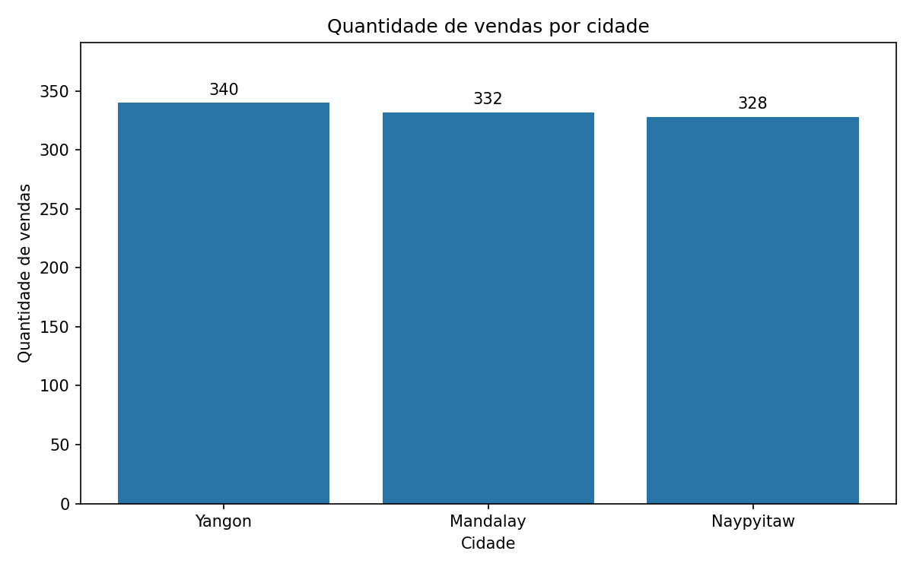
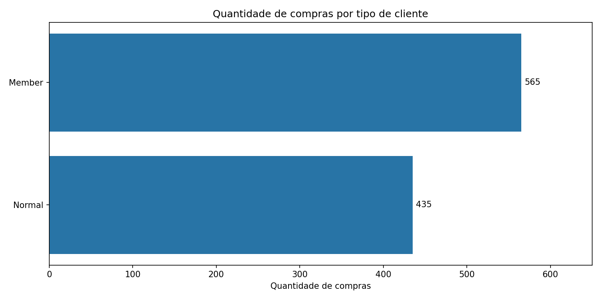
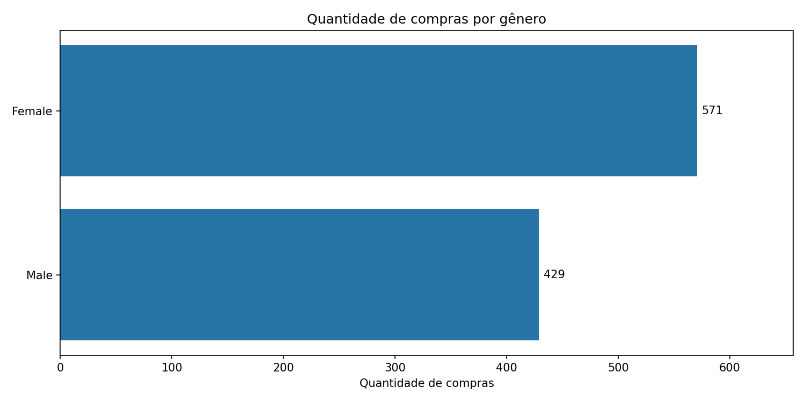
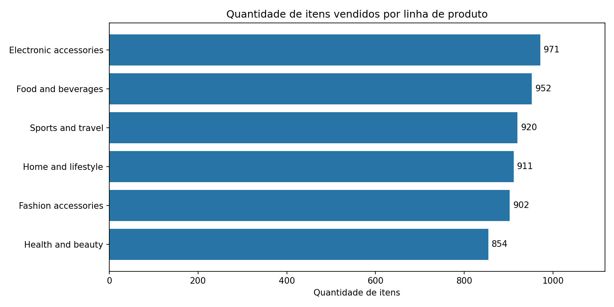
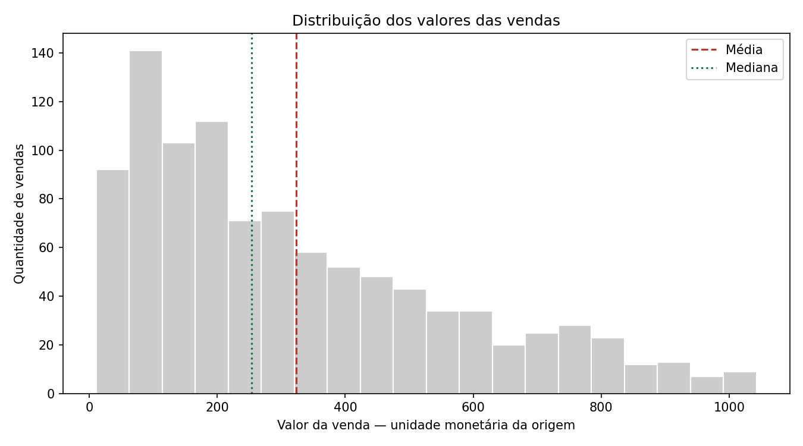
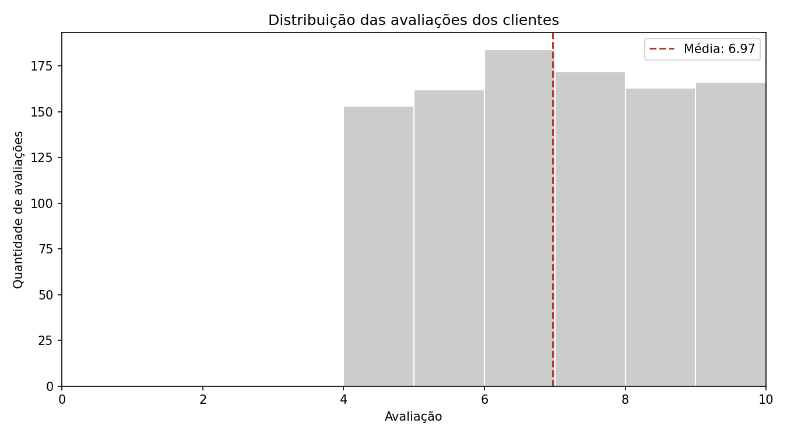

***Criado por:** Ana Paula Francisco Leite*

# Análise de vendas de supermercado

Projeto desenvolvido para o Módulo 1 do curso de Análise de Dados
com Python. O objetivo é construir um fluxo de dados com PostgreSQL,
SQL e Pandas e responder a oito perguntas de negócio sobre vendas.

## Tecnologias utilizadas

- Python
- PostgreSQL
- Pandas
- SQLAlchemy e psycopg2
- python-dotenv
- Matplotlib
- Git
- VS Code e DBeaver

## Fonte dos dados

Dataset público Supermarket Sales, disponibilizado no
[Kaggle](https://www.kaggle.com/datasets/faresashraf1001/supermarket-sales).

O arquivo utilizado foi SuperMarket Analysis.csv, com 1.000 registros
e 17 colunas de origem.

## Fluxo do projeto

CSV original → PostgreSQL Raw → exportação SQL com Python →
tratamento com Pandas → CSV tratado e PostgreSQL Tratada →
estatísticas, respostas de negócio e gráficos.

A camada Raw preserva os valores de origem como texto.
A camada tratada contém dados convertidos e validados.
O CSV tratado também inclui as colunas derivadas ano_mes e dia_semana.


## Instalação e execução

### 1. Pré-requisitos

- Python instalado e disponível no terminal.
- PostgreSQL instalado e em execução.
- DBeaver ou outra ferramenta para executar SQL.

O projeto foi executado com Python 3.14.4 no Windows.

### 2. Instalar as dependências

Abra o terminal na raiz do projeto e execute:

```powershell
python -m pip install -r requirements.txt
```

### 3. Criar o banco e as tabelas

No DBeaver:

1. Conecte-se ao banco padrão `postgres`.
2. Execute `sql/01_criar_banco.sql` para criar o banco `supermarket`.
3. Abra um editor SQL conectado ao banco `supermarket`.
4. Execute `sql/02_criar_tabelas.sql` para criar as tabelas
   `raw_vendas` e `tratada_vendas`.

Os comandos de criação devem ser executados uma única vez em um
ambiente novo. Se os objetos já existirem, não repita sua criação.

### 4. Configurar a conexão do Python

Copie o arquivo `.env.example` para um arquivo chamado `.env`,
na raiz do projeto, e preencha as configurações locais:

```dotenv
DB_HOST=localhost
DB_PORT=5432
DB_NAME=supermarket
DB_USER=postgres
DB_PASSWORD='sua_senha'
```

O `.env` contém credenciais locais e não deve ser versionado.
Ele está incluído no `.gitignore`.

### 5. Importar o CSV para a camada Raw

O arquivo original deve estar em:

```text
data/raw/SuperMarket Analysis.csv
```

No DBeaver, clique com o botão direito em `raw_vendas` e selecione
Importar dados → CSV.

Configure:

- Codificação: UTF-8.
- Separador: vírgula.
- Cabeçalho: primeira linha.
- Transferência de colunas autogeradas: desmarcada.
- Recriação da tabela: desativada.

Confira o mapeamento:

| Coluna do CSV           | Coluna da Raw           |
| ----------------------- | ----------------------- |
| Invoice ID              | invoice_id              |
| Branch                  | branch                  |
| City                    | city                    |
| Customer type           | customer_type           |
| Gender                  | gender                  |
| Product line            | product_line            |
| Unit price              | unit_price              |
| Quantity                | quantity                |
| Tax 5%                  | tax_5_percent           |
| Sales                   | sales                   |
| Date                    | date                    |
| Time                    | time                    |
| Payment                 | payment                 |
| cogs                    | cogs                    |
| gross margin percentage | gross_margin_percentage |
| gross income            | gross_income            |
| Rating                  | rating                  |

A coluna `id_raw` é gerada pelo PostgreSQL.

Importe uma única vez para a tabela vazia. Repetir a importação
adiciona registros novamente.

Confira a carga:

```sql
SELECT COUNT(*) FROM public.raw_vendas;
```

Para o arquivo utilizado neste projeto, o resultado é 1.000.

### 6. Executar os scripts Python

No terminal, na raiz do projeto, execute nesta ordem:

```powershell
python src/01_leitura_dados.py
```

Consulta a Raw, inspeciona os dados e gera
`data/raw/vendas_raw_exportadas.csv`.

```powershell
python src/02_etl_vendas.py
```

Padroniza as colunas, verifica ausências e duplicidades, converte
tipos, confere cálculos, cria colunas derivadas e arredonda os campos
decimais para duas casas.

Gera o CSV tratado e o relatório de conferências. Também substitui
o conteúdo da tabela `tratada_vendas` dentro de uma transação,
preservando sua estrutura e restrições.

```powershell
python src/03_estatistica.py
```

Calcula as oito respostas de negócio, gera estatísticas descritivas
e salva os gráficos em `resultados/`.

### 7. Conferir os resultados

- Base tratada: `data/processed/vendas_tratadas.csv`.
- Dicionário: `data/processed/dicionario_dados.md`.
- Respostas: `resultados/respostas_negocio.csv`.
- Estatísticas: `resultados/estatisticas_descritivas.csv`.
- Conferências: `resultados/validacao_calculos.csv`.
- Gráficos: arquivos PNG em `resultados/`.

As consultas de exploração e conferência estão em
`sql/03_consultas.sql` e devem ser executadas no banco `supermarket`.
As consultas sobre a tabela tratada dependem da execução prévia do ETL.


## Resultados da análise

A base tratada contém 1.000 vendas. Os resultados foram calculados
com Python/Pandas e as métricas de quantidade, faturamento, avaliação
média e menor venda também foram conferidas no PostgreSQL.

### Respostas às perguntas de negócio

| Pergunta                                    | Resultado                         |
| ------------------------------------------- | --------------------------------- |
| Quantas vendas existem na base tratada?     | 1.000 vendas                      |
| Qual foi o faturamento total?               | 322.967,43                        |
| Qual cidade realizou mais vendas?           | Yangon: 340 vendas               |
| Qual tipo de cliente realizou mais compras? | Member: 565 compras               |
| Qual gênero realizou mais compras?         | Female: 571 compras               |
| Qual linha de produto vendeu mais itens?    | Electronic accessories: 971 itens |
| Qual foi a avaliação média geral?        | 6,97 em uma escala de 0 a 10      |
| Qual foi a menor venda registrada?          | 10,68                             |

Os valores monetários são apresentados na unidade da origem, sem
atribuição de uma moeda não confirmada. As contagens por tipo de
cliente e gênero representam compras, não pessoas únicas.

### Conclusões

- Clientes Member realizaram 56,5% das compras, contra 43,5% de
  clientes Normal. Isso demonstra maior participação em quantidade
  de compras, sem estabelecer a causa dessa diferença.
- O grupo Female realizou 57,1% das compras. Essa participação
  descreve os registros da base e não permite concluir, sozinha,
  diferenças de preferência ou comportamento.
- Electronic accessories liderou em quantidade de itens, com 971
  unidades. Liderança em unidades não significa necessariamente
  liderança em faturamento ou lucro.
- A avaliação média foi 6,97. O histograma permite examinar a
  distribuição das notas, complementando a média.
- O valor médio por venda foi 322,97, acima da mediana de 253,85.
  Essa diferença indica influência de vendas de maior valor sobre
  a média e deve ser interpretada junto ao histograma.

### Gráficos













### Arquivos de apoio

- [Oito respostas de negócio](resultados/respostas_negocio.csv)
- [Estatísticas descritivas](resultados/estatisticas_descritivas.csv)
- [Conferências dos cálculos na precisão original](resultados/validacao_calculos.csv)
- [Dicionário da base tratada](data/processed/dicionario_dados.md)

### Limitações

A análise descreve apenas o período e os registros presentes no
dataset. Não demonstra relações de causa e efeito nem permite
generalizar os resultados para outros períodos.

Os valores da base tratada foram arredondados individualmente para
duas casas decimais. As conferências entre os componentes das vendas
foram realizadas antes desse arredondamento.
